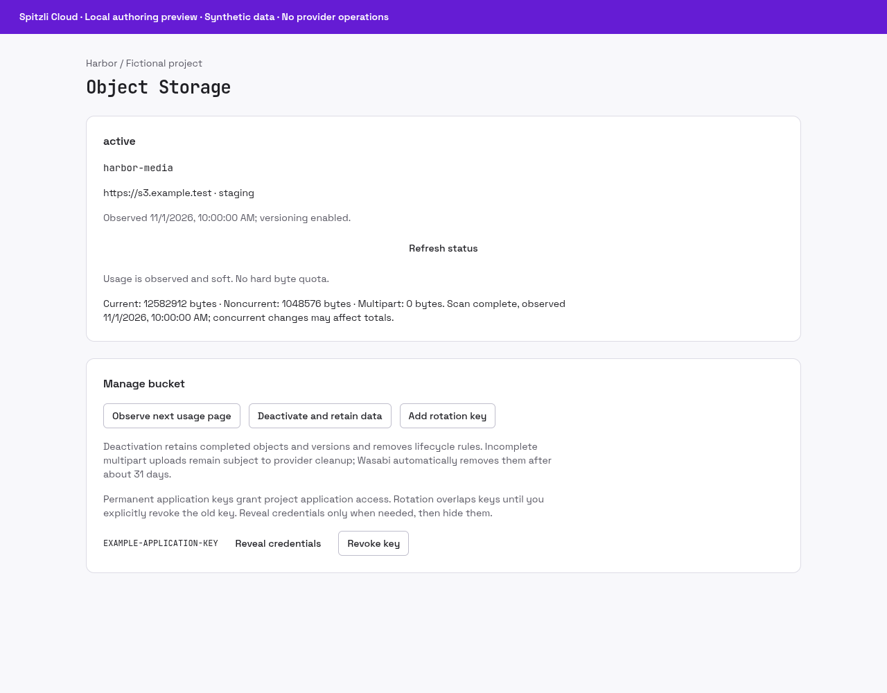

# Object Storage


Manage private application buckets and authenticated browser transfers within your project.

## What you can do

Create buckets, inspect status and observed usage, manage restricted application keys, versioning and lifecycle, upload/download objects, deactivate while retaining data, and explicitly purge/delete.

## Setup and access

Requires an installed native runtime, private PostgreSQL metadata, an approved S3/IAM provider connection and a project grant. Create a bucket for an environment, then create an application key only when needed.

## Data and security

Credentials are sealed and revealed only on request. Core checks current authority for byte transfers. Deactivation removes access and retains completed objects/versions. Rotation overlaps keys until the old key is explicitly revoked.

## Status and limits

Beta; provider and production installation qualification are explicit gates. Usage is observed and soft, not a hard quota. Unknown upload outcomes require reconciliation. ETags and composite checksums are not full SHA-256 values; incomplete multipart cleanup follows provider policy.

Catalog publication does not activate the plugin, enable public signup or grant
access to any customer resource. A new presentation release must use a new version;
previously signed releases and their assets stay immutable.

## Gallery

Actual Object Storage panel; synthetic bucket, observed usage and example key. No provider connection.



## Catalog source

`.tabularium` is the complete catalog-refresh source. It retains the immutable
runtime image and full protocol/access contract of the currently released
`0.5.0` and adds the prepared presentation assets. Refresh it only from a
reviewed immutable source commit. This does not replace signed release assets
or activate the runtime.

## Technical reference

The retained implementation notes below include platform integration procedures.
Commands referring to Core, `tools/` or `apps/console` require the [platform source
checkout](https://github.com/spitzli/webdock); they are not standalone setup steps.

Standalone native plugin. Build and test from the repository root:

```sh
cargo test --manifest-path Cargo.toml --locked
cargo build --manifest-path Cargo.toml --locked
python3 plugins/object-storage/fixtures/fresh.py
```

The package has its own workspace and lockfile. Its default build includes the
maintained AWS S3 and IAM SDK clients; `--no-default-features` tests the control
engine without these transports. PostgreSQL metadata is always enabled; there is
no SQLite/local-directory runtime. Database tests are opt-in in plain `cargo test`;
the fixture runner enables them against a fresh isolated PostgreSQL container,
checks a server restart, then removes its exact container and anonymous volume.
Use `fixtures/fresh.py` for the full PostgreSQL/MinIO suite with fresh isolated
containers and private configurations. It never reads or changes an existing
MinIO service. `fixtures/postgres.py` alone checks PostgreSQL/controlled-provider
behavior; its optional `--minio` requires explicitly authorized fixture configuration.
The native UI retry/create harness runs with:

```sh
bun test --tsconfig-override apps/console/tsconfig.json ./plugins/object-storage/tests/ui.test.tsx
```

The existing `crates/object-storage` byte
adapter is unchanged and not duplicated here.

Read `docs/operations/managed-object-storage.md` in the platform source checkout
for private configuration, invariants, local acceptance, recovery and integration
requirements. Installation remains an explicit operator action; local verification
does not imply a production installation or provider qualification.

Release 0.3 adds browser transfers through authenticated Core descriptors. The
Console hashes a selected file before admission, uploads a raw Blob once, and
streams bounded downloads with full SHA-256 verification when known. Tickets and
bytes stay outside shared query/mutation caches; scope changes cancel work and
retire object URLs. An uncertain upload is never automatically retried.

`objects.observe` is an authorized, active-epoch metadata observation for an
exact object key. It returns size, version, opaque ETag, safe attachment metadata
and a full SHA-256 only when known. Downloads fix the observed version and ETag;
callers may supply a known SHA-256, which remains enforced. Composite checksums
and ETags are never presented as full object SHA-256 values. Release 0.5 rejects
an omitted caller hash when the exact-version HEAD knows a full-object SHA-256;
repeat the checksum returned by `objects.observe`. A known supplied mismatch is
also rejected. Unlabelled/composite metadata remains checksum-unknown. REST and MCP expose
the same metadata and transfer preparation actions; file bytes use Core HTTP.

The reusable Console API is `ApiClient.downloadBinary(descriptor, { signal,
isCurrent }): Promise<Blob>` and `uploadBinary(descriptor, blob, options)`.
`usePluginScope(context)` supplies a current API/principal/project/resource guard;
callers own cancellation and object URL cleanup. `usePluginStorage` additionally
implements the Object Storage inspect/upload/download flow. Other plugins can use
the generic API and scope helper without inheriting bucket-specific actions.

Signed native fixture helpers under `tools/tests/native-object-storage*` reuse
an already-running explicitly authorized MinIO. They create only named owned
local clusters and PostgreSQL services, preserve private evidence, and remove
resources by recorded identities. Their native fixture image/profile is separate
from production, with a pinned mc and verified fixture CA. See the dated
[platform source documentation](https://github.com/spitzli/webdock/tree/HEAD/docs/verification) records for qualified scope; those
historical records are not rewritten for newer releases.
